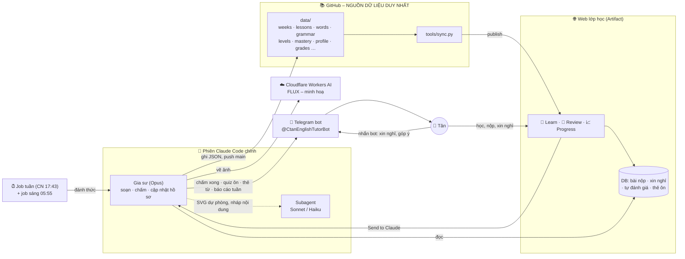
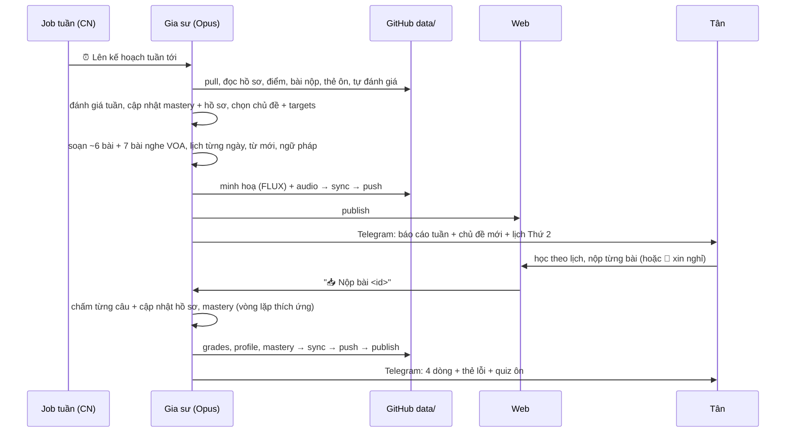

# english-tutor

Khoá học tiếng Anh 1-1 của Tân, với Claude làm gia sư. Bắt đầu ngày 11/11/2026.

- **Mục tiêu:** tiếng Anh phổ thông B1 → C1, theo phương pháp **Comprehensible Input**.
- **Hiện tại:** chỉ tập trung **input** (nghe + đọc). Nghe đang ở mức thoải mái A2+, đọc B1.
- **IT** chỉ chiếm phần nhỏ (≤ 1/10 bài) cho tới khi Tân đạt C1.

File này mô tả **toàn bộ kiến trúc**: các phần của hệ thống, mỗi phần làm gì, dữ liệu chạy qua chúng ra sao.

| Muốn biết… | Đọc |
|---|---|
| Quy tắc bắt buộc cho gia sư | `CLAUDE.md` |
| Cách dạy, khung bài, cách chấm | `tutor/00_TUTOR_GUIDE.md` |
| Định hướng dài hạn | `tutor/01_ROADMAP.md` |
| Schema `data/` + mọi quy trình | `web/README.md` |
| Chọn model và benchmark | `session/MODEL_BENCHMARK.md` |

---

## 1. Tổng quan



| Thành phần | Vai trò |
|---|---|
| **GitHub `data/`** | **Nguồn dữ liệu duy nhất**: kế hoạch tuần, bài, từ vựng, ngữ pháp, checklist trình độ, hồ sơ, điểm, bài nộp. Mọi thứ khác đều sinh ra từ đây |
| **Phiên Claude Code chính** (`session_01VzvjsE7Dz6m9heACFeiGmz`) | Gia sư: soạn bài, chấm, cập nhật hồ sơ, trò chuyện. Mọi việc ở một phiên |
| **Web lớp học** | **Nơi học duy nhất**: chỉ hiển thị `data/` và nhận bài nộp, xin nghỉ, tự đánh giá. Không có link nhảy sang trang khác |
| **Telegram** | Kênh thông báo chính, tin ngắn tiếng Việt |
| **Cloudflare Workers AI** | Vẽ minh hoạ bằng FLUX (miễn phí, khoảng 2 giây/ảnh) |
| **Routines** | Job tuần + job sáng đánh thức phiên chính |

Chỉ có một nguồn dữ liệu là `data/`, nên không có hai bản thông tin phải cập nhật song song và không bị lệch nhau.

## 2. Dữ liệu trong `data/`

| File | Nội dung |
|---|---|
| `weeks.json` | **Kế hoạch theo tuần**: chủ đề, vì sao, mục tiêu, `targets` (mục checklist cần đẩy lên), **lịch từng ngày `days`** (bài sáng/tối + bài nghe VOA `extra`, ngày nghỉ), word wall có hình/IPA/audio, ảnh bìa, review cuối tuần |
| `lessons.json` | Danh sách bài: id, tuần, thứ tự, loại, tiêu đề, ngày, ảnh bìa, trạng thái, chỉ số sau khi chấm |
| `lessons/<id>.json` | Nội dung bài: các phần ① Learn → ② Try it (phản hồi ngay) → ③ Input (đọc/nghe) → ✓ Check, câu hỏi, audio |
| `keys/<id>.json` | Đáp án (không publish lên web) |
| `submissions/<id>.json`, `grades/<id>.json` | Bản chép bài làm và kết quả chấm. Grade gồm nhận xét từng câu, độ căng não 😌/🙂/😵, thẻ lỗi ❌→✅→💡 và quiz ôn cho Telegram |
| `words.json` | **Kho từ**: mọi từ, cụm, từ nối, phrasal verb, idiom đã dạy, mỗi mục có def, ví dụ, nghĩa Việt, hình, IPA (UK/US) và audio |
| `grammar.json` | Thẻ ngữ pháp: mẫu câu, quy tắc, ví dụ, lỗi hay gặp, bài luyện có đáp án |
| `levels.json` + `mastery.json` | Checklist A2 → C1 (nghe, đọc, ngữ pháp, từ nối, từ vựng) và trạng thái từng mục kèm bằng chứng |
| `vocab/` | Danh sách từ theo level (CEFR-J A1–B2, Octanove C1) cho bài word check |
| `review.json` | Lịch ôn trên Telegram: quiz (1 → 3 → 7 ngày), thẻ từ (1 → 3 → 7 → 14 ngày) |
| `library.json` | **Tự sinh** cho tab Review: từ, ngữ pháp, lỗi đã sửa, truyện |
| `profile.json` | **Hồ sơ học sinh**: CEFR từng kỹ năng, `input_level`, điểm mạnh/yếu, sở thích, lịch học, nhật ký quyết định, truyện Hope Street, chat id Telegram, cấu hình vẽ ảnh (`image_gen`) |
| `flux_cast.json` | Mô tả cố định các nhân vật truyện (Nam, Linh, Margaret, Jess, Claire, Tom, Mr Patel, Sam), để ảnh giống nhau qua các tuần |
| `sources/voa/` | Bản chép bài VOA Learning English (public domain) |
| `img/`, `audio/` | Minh hoạ (WebP từ FLUX, SVG dự phòng) và MP3 (Piper TTS) |

`python3 tools/sync.py` làm 4 việc:
1. Kiểm tra `data/` hợp lệ.
2. Gom `library.json` và điền IPA còn thiếu.
3. **Sinh lại** `tutor/02_PROGRESS_LOG.md`, bản đọc dễ trên GitHub. Không sửa tay file này.
4. Lập `web/publish_files.json`, danh sách file publish kèm trang.

## 3. Một tuần học



- **Theo tuần, xếp theo ngày:**
  - Mỗi tuần có một chủ đề và một tập truyện Hope Street.
  - Bài xếp vào khung giờ: ngày thường sáng 7:45 và tối 20:30, cuối tuần 9:00, tối đa 2 bài chính một ngày.
  - Mỗi ngày thêm một bài nghe VOA khoảng 15 phút.
- **Xin nghỉ:** Tân bấm 🙋 trên web hoặc nhắn bot Telegram. Gia sư dời bài sang ngày nhẹ sau đó, không dồn bài.
- **Lớp học, không phải bài thi:** mỗi bài dạy kiến thức nền trước (Learn), luyện có phản hồi ngay (Try it), rồi mới tới input và câu hỏi.
- **Mức input thoải mái:**
  - Bài soạn ở mức hiểu ngay, không căng não.
  - Mỗi bài Tân chọn 😌/🙂/😵. Khi 2–3 bài liền 😌 và hiểu ≥90% thì nâng nhẹ; 😵 thì hạ ngay.
- **Luyện phản xạ:** nghe tốc độ tự nhiên nhiều vòng thay vì phát chậm; đọc không quay lại, lần 2 nhanh hơn.
- **Ba lớp an toàn khi nộp bài:**
  1. Send to Claude là đường chính.
  2. `fire_trigger` là đường dự phòng.
  3. Job sáng luôn kiểm tra `inbox`.

## 4. Web lớp học

Link: https://claude.ai/artifact/LX12NEhBjqgC3qv5bvqAC2 (riêng tư)

- **📅 Learn**
  - **This week:** chủ đề, lịch từng ngày (thẻ Today), nút xin nghỉ, word wall có hình + IPA + audio, mục tiêu tuần.
  - **Lessons:** danh sách bài có ảnh nhỏ. Trên điện thoại hiện danh sách trước để Tân chọn bài.
  - **Listening library:** các bài nghe VOA gia sư soạn.
- **🧠 Review**
  - Tra cứu từ và cụm (lọc theo loại), thẻ ngữ pháp, lỗi đã sửa, truyện.
  - Thẻ lật ôn tập cho từ và ngữ pháp, nhắc lại sau 1 → 3 → 7 → 14 → 30 ngày.
  - Mục "What's next".
- **📈 Progress**
  - **Levels:** checklist từng level, tự đánh giá, word check 40 từ.
  - **Stats:** mức hiểu, độ khó, streak.
  - **Profile:** hồ sơ và nhật ký quyết định.
- **Làm bài**
  - Máy tính: bài đọc ghim bên trái, câu hỏi bên phải.
  - Điện thoại: nút 📖 Text mở bài đọc từ dưới lên, thanh tab dưới đáy.
  - Trình phát MP3 nhỏ ghim khi cuộn, phát được trên iPhone.

Quyền của trang:
- `db`: bài nộp, inbox, nháp, tự đánh giá.
- `comments`: Send to Claude.
- `mcp` → `fire_trigger`.
- `tts`, `assets`, `user`.

## 5. Thông báo: Telegram

Bot **@CtanEnglishTutorBot**. Tin ngắn, tiếng Việt, có link `#<id>` tới bài.

| Khi nào | Lệnh | Nội dung |
|---|---|---|
| Chấm xong | `tools/tg.py graded <id>` | 4 dòng tóm tắt, ảnh thẻ lỗi (≤3), quiz ôn vào hàng chờ |
| Mỗi sáng | `tools/tg.py quiz` + `tools/tg.py words` | Quiz ôn đến hạn, ≤4 thẻ từ có hình + audio |
| Chủ nhật | `tools/tg.py weekly <N>` | Ảnh báo cáo tuần |
| Tuần mới, đổi lịch, xin nghỉ, nhắc nhẹ | `tools/notify.py "<HTML>"` | 1–3 dòng |
| Tân nhắn bot | `tools/notify.py --inbox` | Job sáng đọc tin nhắn: xin nghỉ, góp ý |

## 6. Model và minh hoạ

**Chọn model** (chi tiết và benchmark ở `CLAUDE.md` và `session/MODEL_BENCHMARK.md`):
- **Opus (phiên chính):** soạn bài, lên kế hoạch tuần, chấm bài, quyết định thích ứng, xem và chọn ảnh.
- **Sonnet:** nháp nội dung cần đúng nghĩa (thẻ từ, quiz), Opus xem lại trước khi dùng. Vẽ SVG dự phòng cho hình quan trọng.
- **Haiku:** vẽ SVG thẻ từ dự phòng, việc máy móc. **Không** giao soạn nghĩa từ hay ngữ pháp.

**Minh hoạ** (Tân chọn ngày 12/11):

| Thứ tự | Công cụ | Dùng cho |
|---|---|---|
| **1. Chính** | **FLUX.1 Schnell trên Cloudflare Workers AI** – `tools/flux.py` | Ảnh bìa tuần và bài, cảnh truyện, thẻ từ cụ thể. Miễn phí 10.000 neuron/ngày (≈170 ảnh), khoảng 2 giây/ảnh, ảnh WebP 768×576. Vẽ 2 bản, Opus xem và chọn bản đúng nghĩa, tự nhiên nhất |
| **2. Dự phòng** | **Sonnet vẽ SVG** (subagent) | Bìa, cảnh truyện, từ **trừu tượng** (*although, unless…*, sơ đồ, 2 khung so sánh), hoặc khi FLUX lỗi hay vẽ sai 2 lần |
| **3. Dự phòng** | **Haiku vẽ SVG** (subagent) | Thẻ từ đơn giản |

SVG dự phòng phải render ra PNG rồi tự xem lại và sửa (tối đa 3 vòng): tay cầm đúng đồ vật, đồ đặt đúng mặt phẳng, không lơ lửng.

**Đã thử và không dùng:**
- SD-Turbo, SDXL, Sana chạy CPU: chậm, sai nghĩa.
- Emoji ghép hình.
- Ghép mảnh Open Peeps / Kenney / Humaaans: trông chắp vá.
- Pollinations ẩn danh: kém.
- Gemini Nano Banana: gói miễn phí không còn cho tạo ảnh.
- AI Horde: chậm, phải xếp hàng 5–8 phút.

## 7. Công cụ (`tools/`)

| Công cụ | Việc |
|---|---|
| `sync.py` | Kiểm tra `data/`, gom `library.json`, sinh Progress Log, danh sách file publish |
| `flux.py` | Vẽ minh hoạ FLUX trên Cloudflare: `flux.py "<cảnh>" out.webp -n 2 --cast nam,linh` hoặc `--batch jobs.json`. Thất bại thì exit 2, chuyển sang SVG dự phòng |
| `audio.py` | Piper TTS → MP3 cho bài (`<id>`) và từ (`--words <N>`). Cài lại trong container mới: `bash tools/audio_setup.sh` |
| `voa.py` | Lấy bài VOA Learning English: `list <zone>`, `get <url> <id>`. Chỉ dùng bài VOA tự viết |
| `ipa.py` | IPA kiểu từ điển (UK/US), tách âm tiết và dấu trọng âm, dạng yếu |
| `tg.py`, `notify.py`, `render_card.js` | Telegram: tin, thẻ lỗi, quiz, thẻ từ, báo cáo tuần (render ảnh bằng Playwright) |
| `speech/` | Chấm phát âm (Whisper, wav2vec2, Praat), chỉ dùng khi Tân muốn |

## 8. Lịch (Routines)

| Job | Giờ (VN) | Việc | ID |
|---|---|---|---|
| Kế hoạch tuần | **Chủ nhật 17:43** | Đánh giá tuần, soạn đủ bài tuần tới (bài, VOA, từ, ngữ pháp, minh hoạ, audio), báo cáo tuần trên Telegram | `trig_01Hgbchk6sjSmgewKbfhLLyh` |
| Theo dõi hằng ngày | **05:55 mỗi ngày** | Quiz ôn + thẻ từ Telegram, đọc tin bot, chấm bài tồn, xử lý xin nghỉ, chỉnh bài chưa làm, cập nhật Google Calendar, nhắc nhẹ | `trig_0135HZukAJdhjKZqe96UoqAF` |
| Chấm dự phòng | khi trang gọi | Chấm nếu Send to Claude không gửi được | `trig_01AN7RrytvZ5BmXiymy5Ym5M` |

Giờ lẻ (05:55, 17:43) là cố ý: lịch đặt đúng giờ chẵn hay bị dồn tải nên dễ trễ.

## 9. Bí mật và quyền riêng tư

- **Token không bao giờ vào repo.**
  - **Telegram:** biến `TELEGRAM_BOT_TOKEN` trong cài đặt environment, hoặc file `/root/.telegram_token`.
  - **Cloudflare (Workers AI):** lưu ở Network secrets của environment. Proxy tự gắn token vào `api.cloudflare.com`.
  - **Account ID Cloudflare** không phải bí mật, nằm ở `profile.image_gen.cf_account`.
- Câu lệnh vẽ ảnh chỉ mô tả cảnh, không chứa thông tin cá nhân của Tân.
- Không sao chép nguyên văn nội dung có bản quyền. VOA Learning English là public domain, ghi nguồn bằng chữ.

## 10. Cấu trúc repo

```
CLAUDE.md                  ← quy tắc bắt buộc cho gia sư
README.md                  ← file này: kiến trúc
data/                      ← NGUỒN DỮ LIỆU DUY NHẤT (mục 2)
tools/                     ← sync, flux, audio, voa, ipa, tg/notify, speech (mục 7)
tutor/00_TUTOR_GUIDE.md    ← phương pháp, khung bài, cách chấm
tutor/01_ROADMAP.md        ← la bàn + vòng lặp thích ứng
tutor/02_PROGRESS_LOG.md   ← tự sinh từ data/ (đừng sửa tay)
session/SESSION_HISTORY.md ← các quyết định khi thiết lập
session/MODEL_BENCHMARK.md ← benchmark chọn model
audio/LISTENING_LINKS.md   ← nguồn nghe thật (dùng dần khi lên trình)
web/index.html             ← giao diện lớp học
web/README.md              ← schema data/ + quy trình ra bài, chấm, xin nghỉ, minh hoạ
web/publish_files.json     ← tự sinh: file data cần publish kèm trang
```

## 11. Vận hành

| Muốn… | Làm thế nào |
|---|---|
| Đổi giờ, độ dài, độ khó, chủ đề | Nhắn gia sư (chat hoặc Telegram) hoặc ghi vào Feedback cuối bài. Gia sư cập nhật `profile.json` và lịch |
| Nghỉ một buổi hoặc một ngày | Bấm 🙋 ở ngày đó trên web, hoặc nhắn bot Telegram |
| Xem mình đang ở đâu | Tab 📈 Progress (Levels, Stats, Profile), hoặc `tutor/02_PROGRESS_LOG.md` |
| Tạm nghỉ dài | Nhắn gia sư để tắt job, bật lại khi học tiếp |
| Container mới | `bash tools/audio_setup.sh` (Piper). Playwright đã có sẵn. Token nằm trong environment nên không mất |
| Phiên chính mất (archive/xoá) | Mở phiên Claude Code mới với repo này. Gia sư đọc `CLAUDE.md` + README, trỏ các job sang phiên mới và bật theo dõi trang web (`ArtifactComments watch`). Dữ liệu không mất vì nằm trong `data/` |
