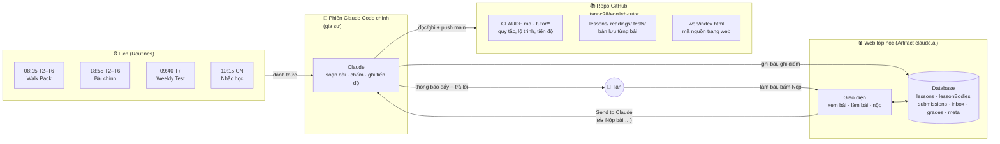
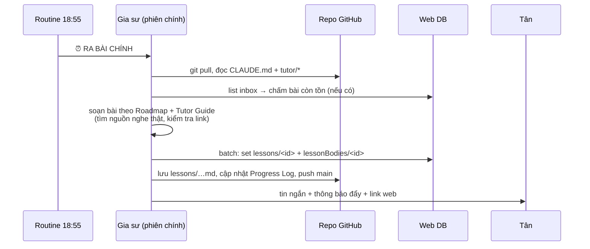
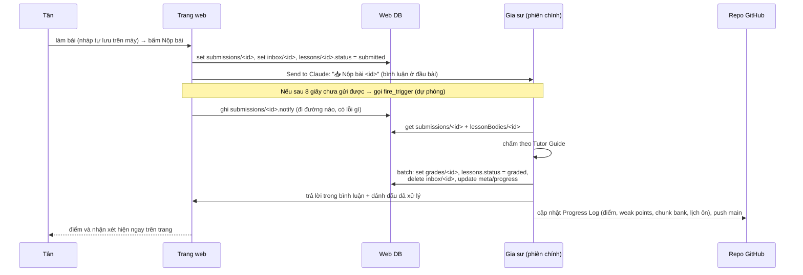

# english-tutor

Khoá học tiếng Anh 1-1 của Tân, với Claude làm gia sư. Mục tiêu: **tiếng Anh phổ thông B1 → C1** theo phương pháp **Comprehensible Input**. IT chỉ là phụ cho tới khi đạt C1. Bắt đầu ngày 11/11/2026.

File này mô tả **toàn bộ kiến trúc**: hệ thống gồm những phần nào, mỗi phần làm gì, và một bài học đi từ lúc soạn tới lúc chấm như thế nào. Cách dạy (phương pháp, khung bài) nằm ở `tutor/00_TUTOR_GUIDE.md`. Quy tắc gia sư phải theo nằm ở `CLAUDE.md`.

---

## 1. Tổng quan



Có **4 thành phần**:

| Thành phần | Là gì | Vai trò |
|---|---|---|
| **Phiên Claude Code chính** | Một phiên chat cố định trên claude.ai/code, gắn với repo này (`session_01VzvjsE7Dz6m9heACFeiGmz`) | "Lớp học". Gia sư nằm ở đây: soạn bài, chấm, trò chuyện, ghi tiến độ. Mọi việc diễn ra trong **một phiên duy nhất** |
| **Repo GitHub** | `tannc28/english-tutor` | "Thư viện" và trí nhớ dài hạn: quy tắc, lộ trình, tiến độ, bản lưu mọi bài. Mỗi phiên, gia sư đọc repo trước để biết mình đang ở đâu |
| **Routines (lịch)** | Các lịch hẹn giờ trên claude.ai, gửi tin vào phiên chính | "Chuông báo giờ học". Đến giờ thì đánh thức gia sư để ra bài |
| **Web lớp học** | Một trang Artifact riêng tư trên claude.ai, có database kèm theo | "Vở bài tập". Tân đọc bài, làm bài, nộp bài, xem điểm |

---

## 2. Phiên Claude Code chính (gia sư)

- Chạy trong một container trên cloud. Container có thể bị thu hồi khi phiên nghỉ lâu, nên **mọi thứ cần giữ đều phải push lên GitHub** (gia sư push thẳng `main`, xem `CLAUDE.md`).
- Phiên được đánh thức theo 3 cách:
  1. **Tân nhắn tin** trực tiếp, ví dụ để hỏi bài hay nói chuyện (Talk Time).
  2. **Routine đến giờ** gửi một tin "⏰ …" vào phiên.
  3. **Tân bấm Nộp bài trên web**: trang gửi một bình luận "📥 Nộp bài …" tới Claude, và bình luận đó đánh thức phiên này (phiên đang *theo dõi* trang web).
- Nếu phiên đang bận (đang trả lời dở), tin mới sẽ **xếp hàng** và chạy ngay khi lượt hiện tại xong. Vì vậy bài có thể đến trễ vài phút so với giờ hẹn.
- ⚠️ Nếu phiên này bị **archive hoặc xoá**, lịch và nút Nộp sẽ không còn chỗ để gửi tới. Khi đó phải tạo phiên mới và trỏ lại các Routine (xem mục 8).

## 3. Repo GitHub – trí nhớ dài hạn

```
CLAUDE.md                  ← quy tắc bắt buộc cho gia sư (đọc đầu tiên mỗi phiên)
README.md                  ← file này: kiến trúc
tutor/00_TUTOR_GUIDE.md    ← phương pháp, khung bài, lịch, cách chấm
tutor/01_ROADMAP.md        ← lộ trình Phase 1 (Input) → 2 (Output) → 3 (Tích hợp)
tutor/02_PROGRESS_LOG.md   ← tiến độ: lịch sử bài, điểm, weak points, chunk bank, lịch ôn, ID các Routine
session/SESSION_HISTORY.md ← các quyết định từ lúc khởi tạo khoá học
lessons/YYYY-MM-DD_<loai>.md ← bản lưu từng bài (đề + bài làm + chấm)
readings/                  ← bài đọc (tự viết, hoặc link + tóm tắt; không chép nguyên văn nội dung có bản quyền)
audio/                     ← link bài nghe (LISTENING_LINKS.md)
tests/week-XX.md           ← Weekly Test thứ 7
web/index.html             ← mã nguồn giao diện web lớp học
web/README.md              ← schema database + luồng nộp/chấm chi tiết
```

**Vì sao cần repo khi đã có web?** Database của web chỉ phục vụ việc *làm bài*. Repo mới là nơi gia sư **nhớ**: Tân yếu gì, đã học chunk nào, lần ôn tới là khi nào, và roadmap đã đổi ra sao theo feedback. Mỗi lần được đánh thức, gia sư đọc `CLAUDE.md` → `tutor/*` trước khi làm gì khác.

## 4. Routines – lịch học tự động

| Routine | Giờ (VN) | Việc | ID |
|---|---|---|---|
| Walk Pack | 08:15 T2–T6 | 1 bài nghe dễ (Claude đọc trên web) khi đi bộ + chunk ôn + shadowing | `trig_01JfVVWawW2pV4745EEx34Pn` |
| Bài chính | 18:55 T2–T6 | Ra bài 45–60' theo Comprehensible Input: nghe dễ + đọc rộng (truyện dài kỳ) + đọc kỹ có gloss | `trig_0135HZukAJdhjKZqe96UoqAF` |
| Weekly check | 09:40 T7 | ~20 câu kiểm tra hiểu trên input mới + feedback tuần + Talk Time | `trig_01M2RcBmJDEihRszoorXBotS` |
| Nhắc học | 10:15 CN | Tóm tắt tuần + gợi ý Sunday Input | `trig_01TTc69trshZCZ4t2itGAVU9` |
| Nộp bài (dự phòng) | Không có giờ, chỉ chạy khi được gọi | Chấm khi đường báo chính lỗi | `trig_01AN7RrytvZ5BmXiymy5Ym5M` |

- Đây là các lịch **lặp cố định** (cron, múi giờ `Asia/Ho_Chi_Minh`). Không có chuỗi "mốc này hẹn mốc sau", nên không bị đứt.
- Mỗi Routine chứa sẵn một "kịch bản" (prompt) đầy đủ: pull repo → đọc quy tắc → **chấm bài tồn trong `inbox`** → soạn bài → đăng lên web → lưu repo, push → báo Tân.
- Bài **ra trước**, Tân làm lúc nào tiện. Lỡ buổi thì không dồn bài, buổi sau mở đầu bằng phần ôn ngắn.
- Giờ 18:55 thay vì 19:00 là cố ý: lịch đặt đúng giờ chẵn hay bị dồn tải nên dễ trễ.

## 5. Web lớp học

Link: https://claude.ai/artifact/LX12NEhBjqgC3qv5bvqAC2 (riêng tư, chỉ Tân mở được)

Trang có hai phần tách biệt:
- **Giao diện** (`web/index.html`): chỉ là khung hiển thị, gồm danh sách bài, vở làm bài, **trình nghe** (Claude đọc bài nghe bằng giọng đọc, chỉnh tốc độ 0.8–1.1×, lời ẩn cho tới khi bấm hiện) và thanh tiến độ. Thêm bài mới **không** sửa file này. File chỉ sửa khi thêm tính năng hoặc sửa lỗi, rồi publish lại vào cùng link.
- **Database** (kèm theo artifact): chứa toàn bộ bài, bài nộp, điểm.

### Database

| Collection | Ai ghi | Nội dung |
|---|---|---|
| `lessons/<id>` | gia sư | Thông tin cho danh sách: tiêu đề, ngày, loại, số phút, trạng thái `open → submitted → graded` (~200 byte/bài) |
| `lessonBodies/<id>` | gia sư | Nội dung bài (đoạn đọc, link nghe, câu hỏi). **Trang chỉ tải khi Tân mở bài đó** |
| `submissions/<id>` | trang web | Câu trả lời + feedback (độ khó 1–5, chỗ khó nhất, số phút) + nhật ký đường báo `notify` |
| `inbox/<id>` | trang tạo, gia sư xoá | **Hàng đợi bài chưa chấm**. Chấm xong thì xoá, nên bình thường luôn trống |
| `grades/<id>` | gia sư | Điểm, nhận xét, đáp án + sửa lỗi ❌→✅→💡, bài tiếp theo |
| `meta/progress` | gia sư | Phase, tuần, streak, hiện ở đầu trang |

`id` có dạng `YYYY-MM-DD-<walk|main|weekly|sunday>`. Chi tiết từng trường xem `web/README.md`.

**Thiết kế để không phình:** dù có hàng trăm bài, trang chỉ tải danh sách nhẹ + đúng một bài đang mở. Gia sư cũng **không bao giờ đọc cả collection lớn**: chỉ đọc đúng 1 bài theo id, còn việc tồn thì lấy từ `inbox`. Nhờ vậy mỗi lần chấm chỉ tốn vài KB context.

### Quyền

Mọi collection đều chỉ chủ sở hữu (Tân) mới được ghi. Gia sư ghi bằng công cụ `ArtifactData` thay mặt Tân. Trang còn được cấp 3 quyền:
- `comments`: gửi bình luận "Send to Claude", là đường báo chính.
- `mcp` → `Claude Code Remote` / `fire_trigger`: đường báo dự phòng.
- `user`: biết ai đang xem trang.
- `assets`: kho file của trang, dùng để lưu bản thu âm (dạng base64).
- `tts`: đọc bài nghe thành tiếng. Có trên Chrome và app Claude máy tính. App điện thoại có thể chưa hỗ trợ; khi đó trang cho xem lời thay thế.

## 6. Các luồng chính

### 6.1 Ra bài



### 6.2 Nộp bài và chấm



- Đã nộp mà chưa chấm thì Tân vẫn bấm **Sửa và nộp lại** được.
- **Ba lớp an toàn** để không sót bài:
  1. Đường chính: Send to Claude.
  2. Đường dự phòng: `fire_trigger`.
  3. Mọi Routine đều kiểm tra `inbox` trước khi ra bài mới.

  Nếu cả ba đều trượt, Tân nhắn "nộp bài <id>" trong chat là đủ.

### 6.3 Chấm và điều chỉnh lộ trình

Theo `tutor/00_TUTOR_GUIDE.md` mục 8:
- Điểm Reading /10, Listening /10, chép chính tả (dictation) tính % đúng.
- Sửa tối đa 3 lỗi mỗi bài theo dạng ❌ → ✅ → 💡.
- Lỗi lặp lại từ 2 lần trở lên được đưa vào **Weak points**.
- Mỗi chunk mới vào **Chunk Bank** với lịch ôn 1–3–7–14 ngày. Chunk đến hạn sẽ xuất hiện ở phần warm-up / Walk Pack.
- **Feedback bắt buộc** (độ khó, chỗ khó nhất, thời gian) dùng để chỉnh độ khó, độ dài, nguồn của bài sau. Thứ 7 có Weekly Test + feedback tuần để chỉnh Roadmap.

### 6.4 Phát âm & ngữ điệu (thử nghiệm)
Claude không nghe được âm thanh. Bộ công cụ mã nguồn mở trong `tools/speech/` nghe hộ: Whisper xem từ có dễ nghe không, wav2vec2 + espeak-ng tìm âm bị mất hoặc sai (nhất là âm cuối), Praat đo ngữ điệu, tốc độ và ngắt nghỉ. Tân thu âm **ngay trên web** (nút 🎙️ mở trình ghi âm của điện thoại). Bản thu được lưu vào kho file của trang, gia sư lấy về, chạy bộ chấm rồi nhận xét trong phần kết quả. Chi tiết và giới hạn: `tools/speech/README.md`.

### 6.5 Talk Time và hỏi đáp

Tân nhắn trực tiếp vào phiên chính: hỏi lại bài, nhờ giải thích, hoặc nói chuyện tiếng Anh (Talk Time thứ 7). Phiên giữ toàn bộ ngữ cảnh. Thông tin cần nhớ lâu thì gia sư ghi vào Progress Log.

## 7. Giới hạn và lưu ý

- **Độ trễ:** Routine và bài nộp đến phiên trong vòng khoảng 1 phút. Nếu phiên đang bận thì chờ đến khi lượt hiện tại xong. Đã đo: Routine test trễ 3 phút khi phiên bận, bài nộp qua Send to Claude đến sau 3 giây.
- **Đường dự phòng `fire_trigger`:** trong các lần thử, có lúc bài được chấm ở một phiên Claude khác, không hiện trong chat chính và không cập nhật repo. Nên `fire_trigger` chỉ để dự phòng. Nếu điều đó xảy ra, lần chạy lịch tiếp theo sẽ đồng bộ điểm vào Progress Log.
- **Lần đầu dùng trên thiết bị mới**, claude.ai có thể hỏi cho phép trang bình luận / gửi cho Claude hoặc dùng Claude Code Remote. Bấm **Cho phép**.
- **Bản quyền:** không chép nguyên văn bài báo/transcript vào repo, chỉ lưu link + câu hỏi + tóm tắt.
- **Thông báo đẩy** lên điện thoại cần app Claude bật thông báo.

## 8. Vận hành và sửa đổi

| Muốn… | Làm thế nào |
|---|---|
| Đổi giờ học | Nhắn gia sư. Gia sư sửa cron của Routine tương ứng và cập nhật bảng ở mục 4 + Progress Log |
| Đổi cách dạy / độ khó | Nhắn gia sư, hoặc ghi vào Feedback. Thay đổi lâu dài được ghi vào `tutor/00_TUTOR_GUIDE.md` / `01_ROADMAP.md` |
| Sửa giao diện web | Sửa `web/index.html` → publish lại vào cùng link (dữ liệu trong DB không mất) |
| Tạm nghỉ vài ngày | Nhắn gia sư để tắt (disable) các Routine, và bật lại khi học tiếp |
| Phiên chính mất (archive/xoá) | Mở phiên Claude Code mới với repo này. Gia sư đọc `CLAUDE.md` + README, rồi sửa `persistent_session_id` của 5 Routine (hoặc tạo lại) và bật theo dõi trang web (`ArtifactComments watch`) cho phiên mới |
| Xem lịch sử / điểm | Web (từng bài) hoặc `tutor/02_PROGRESS_LOG.md` (tổng hợp) |
