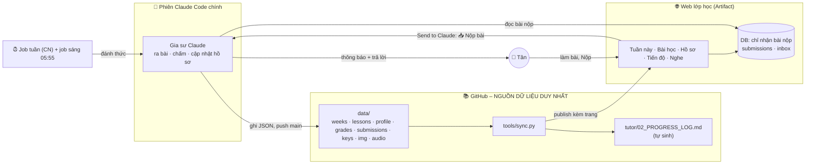
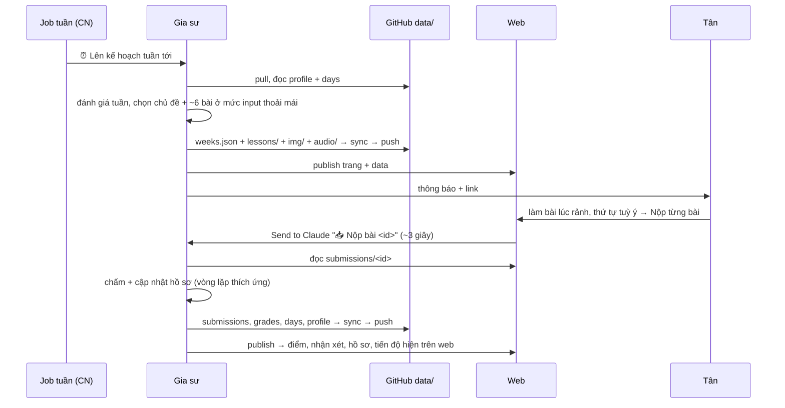

# english-tutor

Khoá học tiếng Anh 1-1 của Tân, với Claude làm gia sư. Bắt đầu ngày 11/11/2026. Mục tiêu: **tiếng Anh phổ thông B1 → C1** theo phương pháp **Comprehensible Input**. Hiện tại chỉ tập trung **input** (nghe + đọc). IT chỉ là phụ cho tới khi đạt C1.

File này mô tả **toàn bộ kiến trúc**: các phần của hệ thống, mỗi phần làm gì, và dữ liệu chạy qua chúng ra sao.
Cách dạy nằm ở `tutor/00_TUTOR_GUIDE.md`, định hướng ở `tutor/01_ROADMAP.md`, quy tắc cho gia sư ở `CLAUDE.md`.

---

## 1. Tổng quan



| Thành phần | Vai trò |
|---|---|
| **GitHub `data/`** | **Nguồn dữ liệu duy nhất**: bài học, điểm, hồ sơ học sinh, tiến độ từng ngày, bản chép bài nộp. Mọi thứ khác đều được sinh ra từ đây |
| **Phiên Claude Code chính** (`session_01VzvjsE7Dz6m9heACFeiGmz`) | Gia sư: ra bài, chấm, cập nhật hồ sơ, trò chuyện. Mọi việc ở một phiên duy nhất |
| **Job tuần (Chủ nhật 17:43)** | Đánh giá tuần, lên kế hoạch + soạn đủ bài tuần tới (chủ đề, truyện, word wall, minh hoạ, audio) |
| **Job sáng 05:55** | Chấm bài tồn, điều chỉnh bài chưa làm theo feedback, cập nhật lịch, nhắc nhẹ nếu 2 ngày không học |
| **Web lớp học** | Chỉ **hiển thị** `data/` (bài, hồ sơ, tiến độ) và **nhận bài nộp**. Không phải nơi lưu dữ liệu gốc |

Vì chỉ có một nguồn (`data/`), không có hai bản thông tin phải cập nhật song song, nên không bị lệch nhau.

## 2. Dữ liệu trong `data/`

| File | Nội dung |
|---|---|
| `weeks.json` | **Kế hoạch theo tuần**: chủ đề, vì sao, mục tiêu, word wall có hình, bài nghe tự do; các tuần tới (chủ đề) |
| `lessons.json` | Danh sách bài: tuần, thứ tự, loại, tiêu đề, trạng thái, mức hiểu nghe/đọc, độ khó, độ căng não, phút thực tế, nhận xét |
| `profile.json` | **Hồ sơ học sinh**: CEFR ước lượng từng kỹ năng, điểm mạnh, cần cải thiện, sở thích, thói quen, giáo viên nhận xét, đang tập trung, nhật ký quyết định, truyện dài kỳ, chunk bank, phát âm, các thay đổi định hướng |
| `lessons/<id>.json` | Nội dung bài của ngày (bài đọc, bài nghe do Claude đọc, câu hỏi) |
| `grades/<id>.json` | Kết quả chấm: điểm, nhận xét, đáp án + sửa lỗi, bài kế tiếp |
| `submissions/<id>.json` | Bản chép bài làm của Tân |
| `keys/<id>.json` | Đáp án trắc nghiệm (không đưa lên web) |
| `img/`, `audio/` | Minh hoạ (SD-Turbo, SVG) và MP3 (Piper TTS) – tự sinh bằng `tools/illustrate.py`, `tools/audio.py` |

Schema chi tiết và quy trình ghi: `web/README.md`.

`python3 tools/sync.py` làm 3 việc:
1. Kiểm tra `data/` hợp lệ.
2. **Sinh lại** `tutor/02_PROGRESS_LOG.md`, là bản đọc dễ trên GitHub.
3. Lập danh sách file cần publish kèm web.

## 3. Một tuần học



- **Theo tuần, không theo ngày:** cả tuần có sẵn bài, Tân học lúc rảnh. Bài chưa làm không bị dồn hay phạt.
- **Mức input thoải mái:** bài soạn ở mức Tân hiểu ngay không căng não (`profile.input_level`); mỗi bài Tân chọn 😌/🙂/😵 để gia sư chỉnh độ khó.
- **Dạy thích ứng:** mỗi lần chấm, gia sư cập nhật hồ sơ, rồi chọn bài kế tiếp theo hồ sơ và feedback mới nhất. Lý do được ghi lại trong "nhật ký quyết định" (xem ở tab Hồ sơ).
- **Ba lớp an toàn khi nộp bài:**
  1. Send to Claude là đường báo chính.
  2. `fire_trigger` là đường dự phòng.
  3. Job sáng luôn kiểm tra `inbox`.

  Nếu cả ba đều trượt, Tân nhắn "nộp bài <id>" trong chat là đủ.

## 4. Web lớp học

Link: https://claude.ai/artifact/LX12NEhBjqgC3qv5bvqAC2 (riêng tư)

- **🗓 This week:** chủ đề tuần, ảnh bìa, mục tiêu, nút Continue, thẻ bài có hình, word wall (lật thẻ + audio), bài nghe tự do, các tuần tới.
- **📚 Bài học:** danh sách gom theo tuần. Vở làm bài có trình nghe (file MP3 phát được trên iPhone, chỉnh tốc độ 0.75–1.1×, lời ẩn tới khi bấm hiện), nút thu âm (khi cần), thanh tiến độ và nút Nộp. Kết quả chấm hiện ở đầu bài.
- **👤 Hồ sơ:** CEFR ước lượng từng kỹ năng, giáo viên nhận xét, điểm mạnh, cần cải thiện, sở thích, đang tập trung, và vì sao bài lại như vậy.
- **📈 Tiến độ:** số ngày học, streak, mức hiểu nghe/đọc (5 bài gần nhất và cả khoá), biểu đồ mức hiểu theo ngày, bảng đánh giá từng ngày.

Quyền của trang:
- `db`: chỉ nhận bài nộp.
- `comments`: Send to Claude.
- `mcp` → `fire_trigger`: đường báo dự phòng.
- `assets`: bản thu âm.
- `tts`: đọc bài nghe. Chạy trên Chrome và app Claude máy tính; trên điện thoại có thể chỉ hiện lời.
- `user`.

## 5. Lịch (Routines)

| Job | Giờ (VN) | Việc | ID |
|---|---|---|---|
| Kế hoạch tuần | **Chủ nhật 17:43** | Đánh giá tuần → soạn đủ bài tuần tới | `trig_01Hgbchk6sjSmgewKbfhLLyh` |
| Theo dõi hằng ngày | **05:55 mỗi ngày** | Chấm bài tồn, chỉnh bài chưa làm, cập nhật lịch, nhắc nhẹ | `trig_0135HZukAJdhjKZqe96UoqAF` |
| Chấm dự phòng | khi trang gọi | Chấm nếu Send to Claude không gửi được | `trig_01AN7RrytvZ5BmXiymy5Ym5M` |

05:55 thay vì 06:00 là cố ý: lịch đặt đúng giờ chẵn hay bị dồn tải nên dễ trễ. Job gửi vào phiên chính. Nếu phiên đang bận, job chờ tới khi lượt hiện tại xong.

## 6. Phát âm (khi Tân muốn)

Claude không nghe được âm thanh. Bộ công cụ mã nguồn mở trong `tools/speech/` nghe hộ:
- **Whisper:** xem từ có dễ nghe không.
- **wav2vec2 + espeak-ng:** tìm âm bị mất hoặc sai, nhất là âm cuối.
- **Praat:** đo ngữ điệu, tốc độ, ngắt nghỉ.

Tân thu âm ngay trên web. Hiện chưa dùng vì đang tập trung input. Chi tiết: `tools/speech/README.md`.

## 7. Cấu trúc repo

```
CLAUDE.md                  ← quy tắc bắt buộc cho gia sư
README.md                  ← file này
data/                      ← NGUỒN DỮ LIỆU DUY NHẤT
tools/audio.py, illustrate.py ← MP3 (Piper) và minh hoạ (SD-Turbo)
tools/sync.py              ← kiểm tra data/, sinh Progress Log, danh sách file publish
tools/speech/              ← chấm phát âm
tutor/00_TUTOR_GUIDE.md    ← phương pháp, khung bài, cách chấm
tutor/01_ROADMAP.md        ← la bàn + vòng lặp thích ứng
tutor/02_PROGRESS_LOG.md   ← tự sinh từ data/ (đừng sửa tay)
session/SESSION_HISTORY.md ← các quyết định khi thiết lập
audio/LISTENING_LINKS.md   ← nguồn nghe thật
web/index.html             ← giao diện
web/README.md              ← schema data/ + quy trình ra bài/chấm
web/publish_files.json     ← tự sinh: file data cần publish kèm trang
```

## 8. Vận hành

| Muốn… | Làm thế nào |
|---|---|
| Đổi giờ, độ dài, độ khó, chủ đề | Nhắn gia sư, hoặc ghi vào Feedback cuối bài. Gia sư cập nhật `data/profile.json` và lịch nếu cần |
| Xem mình đang ở đâu | Tab **Hồ sơ** và **Tiến độ** trên web, hoặc `tutor/02_PROGRESS_LOG.md` trên GitHub |
| Tạm nghỉ | Nhắn gia sư để tắt job. Bật lại khi học tiếp |
| Phiên chính mất (archive/xoá) | Mở phiên Claude Code mới với repo này. Gia sư đọc `CLAUDE.md` + README, trỏ 2 job sang phiên mới, bật theo dõi trang web (`ArtifactComments watch`). Dữ liệu không mất vì nằm trong `data/` |
